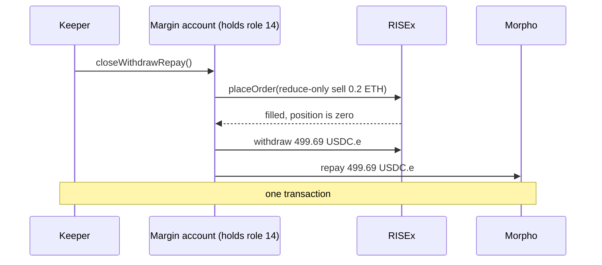

# Portfolio margin liquidation: one transaction, and RISEx's risk engine left alone

**Needs:** [RIP-4](../RIPs/rip-4.md) (the order role). **Status:** run on a fork of RISE mainnet on 17 November 2026; the same pattern ran live on testnet in the credit account experiment's liquidation. **PDF:** [contract-accounts.pdf](contract-accounts.pdf).

A portfolio-margin account borrows against collateral it holds somewhere else and trades the loan on RISEx. RISE's own draft, [RIP-2](https://docs.risechain.com/docs/risex/rips/rip-2), describes one: a sub-account pledges WETH on Morpho, borrows USDC, and deposits it as RISEx margin. When the account's combined ratio passes 0.95, RIP-2 says the liquidation closes perps and repays the loan "in a single atomic transaction", and that each protocol keeps its own risk engine.

That liquidation needs the order role, and nothing in RISEx's margin or liquidation code has to change for it.

## Why it needs the role

A liquidation has three steps: close the perp position, withdraw the USDC from RISEx, repay the loan. Deposits and withdrawals on RISEx are open to any contract. Placing an order is not.

On mainnet on 17 November 2026 (block 27,294,719), AccessManager reported role 14 on `PerpsManager.placeOrder` and on the router's `placePerpsOrder`, and `canCall` returned false for an address without it. So today a third-party margin account can close only through the hosted API, with a session key, in its own transaction. The withdrawal and repayment follow in a second one.

We ran that two-step version on a fork and it works. It has two costs. Between the two transactions the position is closed but the loan is unpaid, and anything can happen to the collateral price in that gap. And the liquidation depends on RISE's API answering at the moment markets are busiest.

## What ran

A sub-account pledged 1 WETH on Morpho's WETH/USDC.e market on a fork of RISE mainnet (block 26,080,000), borrowed 500 USDC.e, deposited it on RISEx and opened a 0.2 ETH long. RISEx's mark was then moved down 1.5%.



| Step | Result |
| --- | --- |
| Before the call | RISEx equity 493.11 USD against 11.78 of maintenance margin. RISEx's own liquidator, called on the account, reverted: the account was healthy by RISEx's rules |
| One call from the keeper, account holding role 14 | Position closed, 499.69 USDC.e withdrawn and repaid. Debt went from 500.00 to 0.30, still covered by the 1 WETH |
| The same call, account without the role | Reverted. The position stayed open |

The position is small because the test was about the order of events, not size.

The account's one extra function, simplified:

```solidity
function closeWithdrawRepay(MarketParams calldata loan, PlaceOrderParams calldata close)
    external onlyKeeper
{
    require(close.reduceOnly);
    perpsManager.placeOrder(close);   // trades for msg.sender, so this account needs role 14
    require(perpsManager.getPosition(close.marketId, address(this)).size == 0);

    uint256 amount = collateralManager.getWithdrawableUSDC(address(this)) / 1e12;
    collateralManager.withdraw(address(this), USDC, amount);
    morpho.repay(loan, amount, 0, address(this), "");
}
```

## Why RISEx's risk engine is untouched

- **The close is an ordinary order.** The account sells reduce-only for itself, the way any trader closes. RISEx's matching, margin check and fees apply as usual.
- **RISEx's liquidation still reads the same account.** Nothing about the account's RISEx margin changes because a loan sits behind it. In the fork run RISEx's liquidator had nothing to do, because the margin product acted first. Had the product been late, RISEx would have liquidated the perp leg exactly as it does for an EOA.
- **RISEx never prices the collateral.** The WETH sits in Morpho. Whether it is worth enough is the lender's question, answered by the Morpho market's own threshold and liquidators.

So the extra leverage a margin product gives (trading a loan rather than your own cash) is underwritten by the lender on the other protocol, not by RISEx's insurance fund or its reserve vault.

## Limits

- **The product's trigger has to come first.** If the margin product only acts after RISEx's maintenance line, RISEx's liquidator gets there first and the loan is left to its collateral. Past RISEx's takeover line a liquidator is refused (`AccountMustBeTakenOverByRLP` on a fork) and only RISEx's reserve vault can take the position.
- **Two price feeds.** The loan is valued by the money market's oracle and the perp by RISEx's mark. A product has to decide what it does when they disagree.
- **A close can cost more than the margin.** The run above left 0.30 of debt after a 1.5% move. A larger move leaves more, and the collateral has to cover it.
- **One fork run is not an audit.** The account here is a test contract.

## The same pattern, live

The [credit account](credit-accounts.md) experiment lends USDC.e against a trader's RISEx margin and pledge. Its liquidation ran live on RISE testnet through a contract holding the order role: health line 0.9985, `startLiquidation`, the liquidator's reduce-only close, then `liquidate`. The debt was repaid in full and the lenders' share price did not fall.

RIP-1 lists liquidation-protection keepers as a use for sub-accounts. They are this page with a gentler trigger: close part of the position before anyone has to liquidate.
