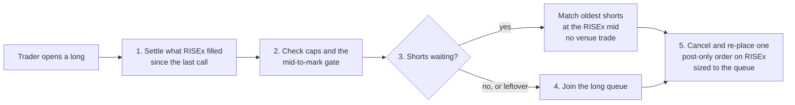

# Synthetic book: a Papertrade-style perps book with real liquidity behind it

**Needs:** [RIP-4](../RIPs/rip-4.md) (the order role). **Status:** live on RISE testnet since 13 November 2026; the 100× figures are from a fork run on 17 November. **PDF:** [synthetic-book.pdf](synthetic-book.pdf).

The synthetic book gives traders the experience of a simple synthetic perps app (one pool, one price, no order book to read) while every position is backed either by another trader or by a real order on RISEx. Liquidity providers hold no directional exposure. What they do carry is the shortfall when a trader loses more than their margin.

The book can offer more leverage than RISEx does, and RISEx does not carry it. On a fork, traders ran at 94× while RISEx saw the book as one account at 4× ([where the leverage risk sits](#where-the-leverage-risk-sits)).

## The rule

There is only ever one queue, on one side, and one resting order on RISEx. The order's size always equals the queue's total.

A trader in the queue has no position yet. They get one when a trader on the other side arrives, or when RISEx fills the resting order. So the book's positions and its RISEx position are always equal, and the pool holds nothing directional.



All five steps run in one transaction. That is why the book needs RISEx's order role: the resting order on the venue must change in the same transaction as the queue it mirrors.

## A trade, in order

1. **Settle what RISEx filled.** Read the book's RISEx position. Whatever the resting order filled since the last call is handed to the traders at the front of the queue, oldest first, at the resting order's price.
2. **Check the trade is allowed:** order cap, the side's total cap, and RISEx's mid and mark within a gate.
3. **Match against the other side's queue,** oldest first, at the current RISEx mid. Nothing trades on RISEx.
4. **Whatever is left joins the queue** at the back.
5. **Replace the resting order:** cancel the old one and place a new post-only order at the current mid for the queue's new total.

| Fill | Price |
| --- | --- |
| Matched with a trader waiting in the queue | RISEx mid at the moment of the match, for both traders |
| The resting order filled on RISEx | The resting order's price |
| Close sent to market | The RISEx fill price |
| Liquidation | The RISEx fill price |

The same five steps in the contract, simplified:

```solidity
function _order(address trader, int256 delta) internal {
    _sync();                           // 1. settle what RISEx filled, read from the book's position
    _cancelResting();                  //    and take the old order off RISEx
    _gate(mid, mark, maxMidMarkBps);   // 2. size caps, and the mid inside a gate of the mark
    uint256 left = _matchQueue(trader, delta, mid);   // 3. match waiting traders at the mid
    if (left != 0) _enqueue(trader, left);            // 4. the remainder joins the queue
    _requireMargin(trader, mark);
    _placeResting();                   // 5. one post-only order on RISEx, sized to the queue
}
```

`_cancelResting` and `_placeResting` call RISEx directly. They are the two lines that need the order role.

## How it compares with Papertrade

[Papertrade](https://docs.papertrade.xyz/) on Hyperliquid is the best-known synthetic perps app. Every trade there is a swap between the user and the LP, priced at Hyperliquid's mid, and "no perpetual contracts are traded on Hyperliquid" ([FAQ](https://docs.papertrade.xyz/intro/faq/)). The LP is every trader's counterparty and is not hedged.

| | Papertrade | Synthetic queue book |
| --- | --- | --- |
| Counterparty | The LP, on every trade | Another trader, or RISEx through the resting order |
| LP price exposure | All of the traders' net | No directional exposure: the book's net always equals its RISEx position. The pool pays only when a trader's loss passes their margin |
| When the LP cannot pay winners | Unpaid profit waits in a FIFO queue, repaid from later losses ([Solvency & queue](https://docs.papertrade.xyz/how/solvency-queue/)) | Not needed: each position has a real counterparty |
| Price | Hyperliquid mid, read by a precompile, with no deviation check | RISEx mid read on chain, refused outside a mid-to-mark gate |
| Venue liquidity | None used | The unmatched side rests on RISEx's book |
| Liquidation | A hard bust about 5 bp inside zero equity; the whole margin is forfeit | Waiting traders take what they can at mid; the rest is sold on RISEx, or moved to the front of the queue |
| Cost to a winning trader | On a $10,000 BTC long that wins 100 bp, the trader keeps $86.40 of $100: the impact haircut leaves about $88.16, then a 2% win fee ([Asymmetric impact](https://docs.papertrade.xyz/how/asymmetric-impact/)) | Queue matches pay no venue fee. Resting fills earned the pool a maker rebate on testnet. The fee model is not set; the working assumption is Papertrade's 2% of profit |
| Fill | Instant | Instant if the other side is waiting, otherwise when RISEx fills the resting order (seconds on testnet) |

What the queue book gives up: a trader may wait for a fill, a liquidation can walk RISEx's book, and the design needs the order role on RISEx.

## Liquidation

Anyone may call either route once a trader is below maintenance.

- `liquidate(trader)`: waiting traders on the other side take what they can at mid, and the rest is sold on RISEx in the same transaction. Fast, but a large position walks the book.
- `liquidateToQueue(trader)`: waiting traders take what they can, and the rest goes to the front of the queue. It leaves through the resting order or the next trader on the other side, so nothing walks the book. The position stays open until then, and `liquidate` can finish it at any time.

## Where the leverage risk sits

The book's leverage limit is its own setting. RISEx never sees a trader's position, only the book's account, which holds the whole pool and every trader's margin against the book's net position. So a trader can be at 100× while the account RISEx margins is at a few times.

We ran the book at a 100× limit on a fork of RISE testnet (block 59,313,000, ETH mark 2,064.87, RISEx's own maximum for the market 50×). The pool held 10,000 USDC. Four traders each opened 5 ETH long on 110 USDC of margin, which filled the book's 20 ETH cap on one side.

| | Inside the book | What RISEx sees |
| --- | --- | --- |
| Accounts | Four traders | One account |
| Position | 5 ETH long each, 10,324 USD notional | 20 ETH long, 41,297 USD notional |
| Leverage | 94× each | 3.95× |
| Cover | 110 USD of margin each | 10,442 USD of equity, 19 times RISEx's maintenance margin of 551 |

Then the price gapped down 3% before any liquidation ran.

| After a 3% gap | Result |
| --- | --- |
| Traders | All four bankrupt: each had lost about 310 USD against 110 of margin |
| The book's RISEx account | 4.35× leverage, equity still 17 times maintenance. RISEx's liquidator had nothing to do |
| Liquidations inside the book | Four calls sold 20 ETH on RISEx; the book's RISEx position returned to zero |
| Who paid | The pool: 808 USDC, 8.1% of its value |

In the orderly case the pool pays nothing. One trader at 94× with 22 USDC of margin was liquidated after an 80 bp move. The trader kept 2.97 USDC, the keeper earned 2.05, and pool value did not change.

By arithmetic on the same figures, RISEx's own liquidator would reach the book's account only after a move of about 24% with no liquidation inside the book at all. Before that, every loss is absorbed by trader margin and then by the pool.

**What RISEx gets.** The book's unmatched side rests on RISEx as a post-only order at the mid, so it adds depth inside the spread. Market closes and liquidations arrive as taker orders, and the book's net position is open interest on RISEx. Trades matched between two of the book's own traders never reach RISEx. The venue gets the book's net flow, not its gross.

**What higher leverage costs the book.** Three things tighten as the limit rises.

- The pool is the insurance fund. A gap larger than a trader's margin is the pool's loss, and at 100× that is any gap over 1%.
- The mid-to-mark gate must fit inside the gap between initial and maintenance margin, and the contract refuses parameters that break this. At 100× with 0.5% maintenance the gate must be under 50 bp (the run used 40). Testnet ETH runs a 1% gate at 20×. Testnet BTC, whose mid sits about 1% from the mark, could not run 100× at all.
- A resting order that fills at a stale price hurts sooner. The 20× trader in the table under "Known weaknesses" was bankrupt on arrival after a 7% move; at 100× a 1% move does it.

## More than one market

Each market has its own book and pool, so a lender to the BTC pool carries no ETH risk. Only the ETH book holds RISEx's order role. It also routes orders for the BTC book: it builds a router permit whose signer is the BTC book, and the BTC book's `isValidSignature` approves only the permit the router is presenting for it at that moment. The position, margin and fills stay in the BTC book's own RISEx account.

## What ran live on RISE testnet

| Step | Result |
| --- | --- |
| Open a 0.1 ETH long | Queued; a resting buy placed at 1,934.42, the mid of 1,933.49 and 1,934.38 |
| RISEx filled the resting buy | Within seconds, by another RISEx trader |
| Settle the fill | Position 0.1 ETH at 1,934.42; pool up 0.0097 USDC, the maker rebate |
| Close at market | RISEx position back to zero; the trader paid 0.134 USDC (about 7 bp); pool value unchanged |
| Two traders match in the queue | A market close of a 0.1 ETH long was taken by a waiting buyer at the mid of 1,932.11, with no RISEx trade |
| BTC book behind the ETH router | Deployed, registered and traded on 14 November |

On a fork of RISE: a 2% price move with one hedged 1 ETH long changed pool value by under 0.05 USDC; a liquidation after a 4% drop cost the pool nothing; after a 7% drop the pool absorbed under 40 USDC.

Testnet contracts: ETH book proxy `0xb070893EC0a416AC72ddD77D226f9513B327B1f1`, BTC book proxy `0x4CebD759CE967967Ca922eA63B6FB96d8fa4B8fb` (RISE testnet, chain 11155931).

## Known weaknesses

| Weakness | Status |
| --- | --- |
| A resting order fills at its own price however far the market has moved; a 7% drop before the keeper re-prices left a 20× trader bankrupt on arrival in a test | Mitigated: the keeper re-prices on every meaningful move of the mid, and the resting order carries an expiry on RISEx so a stopped keeper leaves it exposed for at most 10 minutes |
| Funding on the RISEx position is not passed to traders | Open |
| A trader past bankruptcy counts at negative equity until liquidated, so an LP can withdraw ahead of the loss | Open |
| Matches settle at a mid anyone can quote into | Bounded by the mid-to-mark gate (1% on testnet ETH) and size caps |
| RISEx's minimum order is 0.1 ETH; a smaller remainder waits with no resting order | By design |

## Venue facts the build turned up

- RISEx deletes filled and cancelled orders and reuses their IDs, so the book reads fills from its position, never from a remembered order ID.
- A post-only order that would cross reverts, so a resting buy rounds the mid down and a sell rounds it up.
- Orders expire on fixed 5-minute clock boundaries, and an expired order stays in the open-order list until something touches it.
